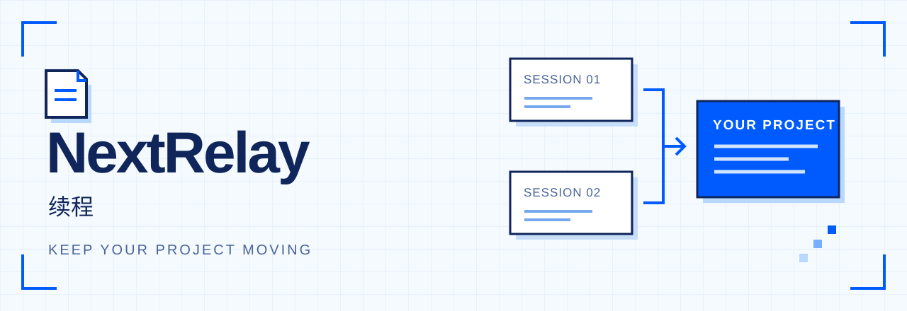
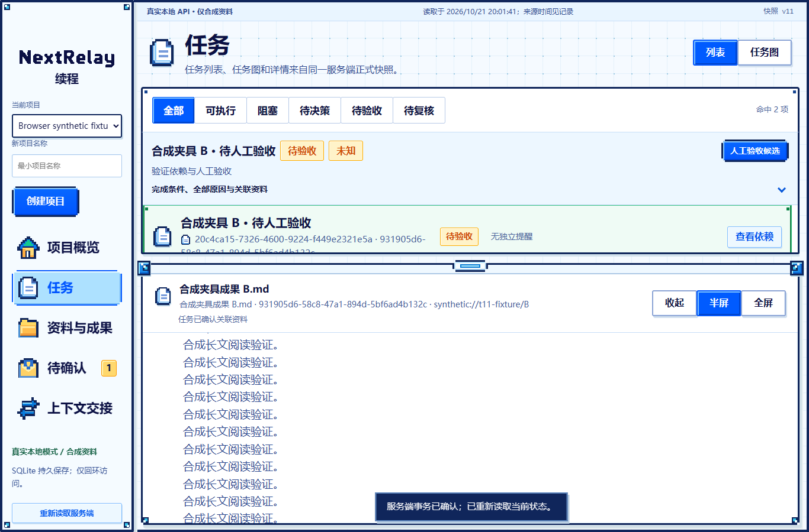
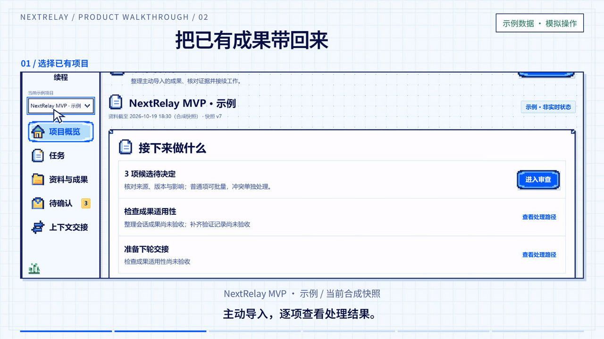
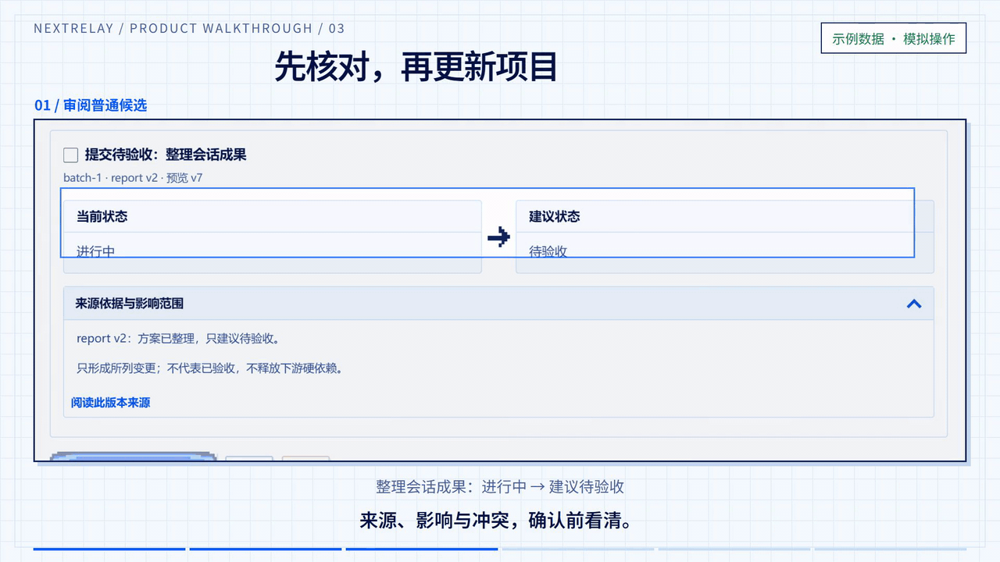
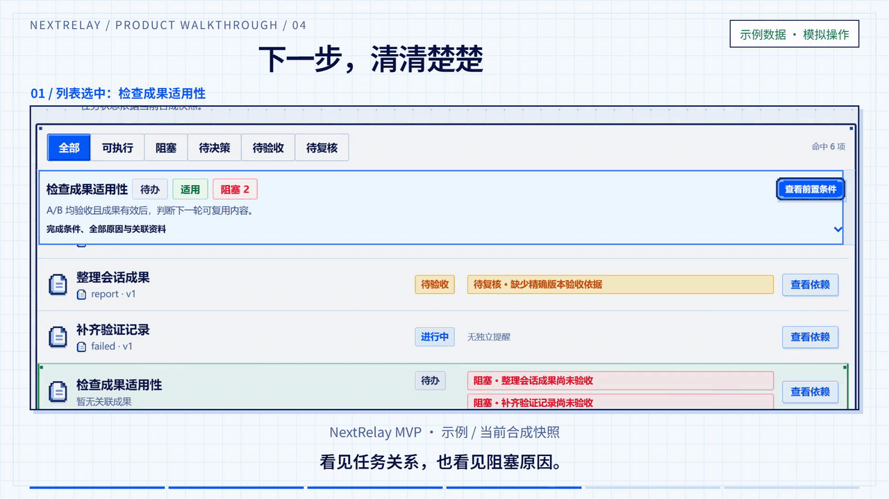
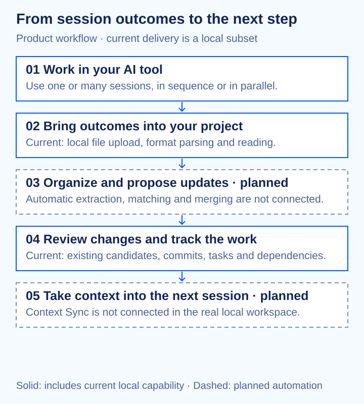

  

<h2 align="center">Conversations end. Progress continues.</h2>

A general-purpose AI work management and coordination platform. Keep project outcomes, task progress, and working context together across sessions.

  <a href="#see-the-workflow">Demo</a> ·
  <a href="#inside-nextrelay">Architecture</a> ·
  <a href="README.zh-CN.md">简体中文</a>

  

## Your next session should start with the work you already did

A new AI conversation starts, and you explain the project again. Several sessions move forward at once, and their outcomes end up in different places. What changed? Which task is blocked? Which decision still applies?

**NextRelay is designed to make that project history usable.** Bring in the outcomes you choose to share, understand where the project stands, and prepare for the next step.

- **Keep working in familiar AI tools.** One platform or several; one session or many. You do not need NextRelay to launch a session or require a particular prompt or Skill.
- **Bring the work together.** The product design connects outcomes, documents, versions, and evidence to the project they belong to.
- **Understand the next step.** Tasks and dependencies make progress, blockers, and parallel work easier to inspect.
- **Keep decisions deliberate.** A session ending is not task acceptance. Candidate changes, review, and formal commits are separate steps.

Project state reflects the materials provided and their stated evidence. NextRelay does not silently collect conversations or continuously monitor external sessions.

## See the workflow

### 1. Bring session outcomes into the project

Choose the materials, inspect the processing scope, and see a result for each item.

*Current local delivery supports file upload and format parsing.*

### 2. Review what should change

Inspect the proposed state, its source, and its impact before confirming a change.

*Prototype confirmation reaches “awaiting acceptance.” In the real local workspace, saving a candidate, reviewing it, and formally committing it are distinct operations; native extraction is a separate action that saves sourced candidates.*

### 3. Find dependencies and the next step

Move between the task list and graph to inspect prerequisites, blockers, and executable work.

## What works today

Current code: **nextrelay 0.8.0 · schema v8**. This is a local development implementation for synthetic materials, with a separate in-memory prototype.

| Area | Current delivery |
| --- | --- |
| Projects and files | Create/select projects, upload local files, inspect per-item results, and retry failed items. Local format support: TXT, Markdown, protocol JSON, and static HTML. |
| Documents and evidence | Read saved content, named sources, exact artifact versions, and associated evidence. |
| Native organization | Extract actual imported text, match tasks/Sessions/Attempts, retain independent origins, show complements/conflicts, and automatically identify correctable revisions. |
| Changes and history | Save existing-service candidates, review them, commit approved changes, and inspect history and single-change compensating reversal. |
| Tasks and dependencies | Read task lists/graphs and dependency state; existing services support task lifecycle, review, limited checks, and human acceptance. |
| Persistence | The real local mode uses SQLite and an explicitly selected originals directory. The synthetic preview uses memory and resets on refresh. |
| Not connected | Model processing, GitHub repository reading, cloud storage, and Context Sync. Deletion/recovery and full development-readiness flows are also incomplete. |

The local subset is not a completed MVP or a production service; no performance or production-readiness claim is implied.

## Three parts, one continuing project

### Project Black Box — keep the story and its evidence

The product module for bringing user-provided session outcomes together with sources, decisions, and change history. It proposes traceable updates rather than silently changing formal state.

**Today:** local ingestion, content/source/version reading, and reviewed change services provide part of this foundation. Native extraction, inspectable matching, complementary views, conflict detection and correctable version families are available locally.

### Control Tower — understand where the work stands

The product module for task relationships, progress, dependencies, and blockers. Tasks are the graph nodes; prerequisite relationships are its edges. Sessions, attempts, and artifacts can be associated with tasks.

**Today:** the local workspace exposes task lists, a task graph, dependency state, and existing lifecycle/review services. The graph describes work relationships; it does not execute external AI agents.

### Context Sync — prepare the next conversation

The planned module for retrieving current project state and preparing context when a user needs a handoff. The design separates effective context from unresolved reminders.

**Status:** available as a synthetic interaction prototype only. The real local workspace has no Context Sync generation or copy service. [View the prototype clip](video/out/gifs/04-context-handoff.gif).

## How the pieces fit

The workflow is: work in your AI tool → provide outcomes → organize proposed updates → review changes → inspect project state → continue working, with a context handoff when needed. Local native organization is available; real Context Sync remains planned.

## Inside NextRelay

| Layer | Current implementation |
| --- | --- |
| Workspace | HTML/CSS and vanilla JavaScript; a real `LocalAdapter` and a separate in-memory `SyntheticAdapter`. |
| Local application | Python 3.14 standard-library WSGI service, bound to `127.0.0.1`; temporary development Bearer authentication. |
| Business state | SQLite transactions, project revision checks, separate candidate/review/commit operations, and persistent request receipts. |
| Originals | An explicitly selected local directory, with per-file processing and retry history. |

Three mechanisms matter to the product experience:

- **Sources and exact versions:** inspect which material supports a state or decision.
- **Review before formal state changes:** a proposed update is not already an accepted fact.
- **Explicit uncertainty:** incomplete imports, unavailable capabilities, and writes awaiting confirmation remain visible.

**License:** this checkout has no root project license file. Project-wide redistribution terms have not been declared here.

## Run native extraction locally (T08)

Use Python 3.14 and a **new independent synthetic database**, outside this checkout and OneDrive. Set `NEXTRELAY_ENV=development`, `NEXTRELAY_AUTH_MODE=dev-token`, a freshly generated `NEXTRELAY_DEV_TOKEN`, `NEXTRELAY_DB_PATH`, an existing `NEXTRELAY_LOCAL_ROOT`, and a free `NEXTRELAY_PORT`. Run `python -m nextrelay init-db` explicitly, then `python -m nextrelay serve`. The server does not migrate a database on startup. Existing databases need an explicit upgrade while their service is stopped; this task did not upgrade any existing user database.

In the real local workspace, upload UTF-8 TXT, Markdown, protocol JSON or static HTML, then choose **执行／恢复原生提取** on the materials page. Inspect each document's source, exact input fingerprint, field positions, matching decisions and version relationship. Correct attribution or version families there and save current candidates; use the existing review page to review and formally commit them. Extraction never reviews or commits its own output. The separate synthetic mode retains its original behavior.

Native rules recognize labelled `Task/任务`, `Session/会话`, `Attempt/回合`, `Goal/目标`, `Completion conditions/完成条件`, result, decision, risk and gap declarations. Multiple identities use semicolons. Multiple tasks/attempts together with multiple Sessions require explicit `contributions` triples (`task_id`, `session_id`, `attempt_id`; unknown values may be null); identity lists never imply every possible pairing. Exact project-local IDs, unique titles and qualified `namespace::external_id` values are inspectable matching signals. `# Task Descriptive title` and unresolved descriptive task names can propose a minimal new task. Unknown IDs and ambiguous names remain unresolved. JSON uses the existing `nextrelay.import` version 1 protocol; text declarations belong in document `text`, never in new authorization fields. Arbitrary prose is retained with its sections and source; no unrestricted language understanding or model processing is claimed.

HTML native content includes inert heading levels and table-cell structure, with source lines and cell pointers; different cell boundaries are different content. Native processor `nextrelay-native/2` avoids reusing earlier lossy results. Identical content reuses a version but preserves independent origins. Same-title revisions use token-trigram Jaccard similarity >=0.80 with a unique family; similarity alone does not establish authority. Complementary views retain components and facts; contradictory key/value claims become explicit conflicts. Version corrections append family/parent history without moving immutable version rows. Correct a child before detaching its parent. Attribution corrections invalidate old native candidate approvals. Already committed effects use the existing reviewed compensating reversal and a new candidate; editing a suggestion does not undo a formal effect.

Native limits: 100 documents, 256 KiB UTF-8 per document, 2 MiB per input, 200 comparison versions including proposed documents, 40,000 lexical tokens per document, 500 facts/sections and 100 declarations per identity kind. Limits fail explicitly without partial native writes or truncated success; saved T07 originals remain available. These are engineering bounds, not a capacity benchmark.

Authenticated endpoints are documented in Architecture 9.7. Tests: `python -B -W error::ResourceWarning -m unittest discover -s tests -q`; frontend `npm run check`, `npm test`, `npm run build`. `frontend/tests/native-browser.mjs` accepts `--python`, `--playwright`, and optionally `--browser` to run real loopback browser integration in its own temporary directory. No real model, GitHub or cloud account is needed.
