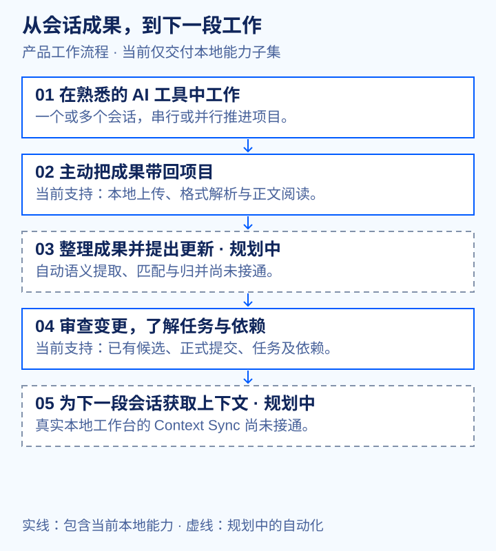

  

<h2 align="center">Conversations end. Progress continues.</h2>

通用 AI 工作管理与协调平台。 把多个会话中的项目成果、任务进展和工作上下文放在一起。

  <a href="#看看工作流程">演示</a> ·
  <a href="#nextrelay-的实现结构">系统架构</a> ·
  <a href="README.md">English</a>

  

## 下一段会话，应该接得住已经做过的工作

新开一个 AI 会话，又要解释一遍项目背景。几个会话同时推进，成果却散落在不同地方。改了什么？哪个任务被阻塞？之前的决定还有效吗？

**NextRelay 的产品目标，是让这些项目历史真正服务于后续工作。** 主动带入你选择分享的成果，了解项目现状，为下一步做好准备。

- **继续使用熟悉的 AI 工具。** 同一平台或多个平台、一个或多个会话均可。无须由 NextRelay 启动会话，也不强制采用特定 Prompt 或 Skill。
- **把工作成果放回项目。** 产品设计将成果、文档、版本和证据关联到所属项目。
- **看清下一步。** 通过任务与依赖了解进展、阻塞以及可以并行的工作。
- **让关键决定保持明确。** 会话结束不等于任务验收；候选变更、审查与正式提交是不同步骤。

项目状态只反映已提供的资料及其证据情况。NextRelay 不静默采集对话，也不持续监控外部会话。

## 看看工作流程

### 1. 把会话成果带回项目

选择资料，核对处理范围，逐项查看导入结果。

*当前本地版本支持文件上传与格式解析。*

### 2. 先核对，再更新项目

查看建议状态、来源依据与影响，再确认变更。

*原型中的确认仅到“待验收”。真实本地工作台将保存候选、审查、正式提交分为独立操作；上传文件不会自动生成候选。*

### 3. 看清依赖，找到下一步

在任务列表与任务图之间切换，检查前置条件、阻塞和可执行工作。

## 当前能做什么

当前代码：**nextrelay 0.7.0 · schema v7**。目前为使用合成资料的本地开发实现，另保留独立的内存交互原型。

| 范围 | 当前交付 |
| --- | --- |
| 项目与文件 | 创建／选择项目、上传本地文件、逐项查看结果、重试失败项。本地格式支持 TXT、Markdown、协议 JSON 和静态 HTML。 |
| 资料与证据 | 阅读已保存正文、具名来源、精确成果版本及关联证据。 |
| 变更与历史 | 使用既有服务保存候选、审查、正式提交已批准变更，查看历史与单次补偿撤销。 |
| 任务与依赖 | 读取任务列表／任务图和依赖状态；既有服务支持任务生命周期、复核、有限检查及人工验收。 |
| 持久化 | 真实本地模式使用 SQLite 与明确选择的原件目录；合成预览使用内存，刷新后重置。 |
| 尚未接通 | 自动语义提取／匹配／归并、模型处理、GitHub 仓库读取、云端保存与 Context Sync。删除／恢复及完整开发准备流程也尚未完成。 |

本地子集不等于完整 MVP 或生产服务，不构成性能或生产就绪承诺。

## 三个模块，接续同一个项目

### Project Black Box — 留下工作经过与依据

负责归并用户主动提供的会话成果，保留来源、决策和变更历史。输出可追溯的候选更新，不静默改写正式状态。

**当前：** 本地导入、正文／来源／版本阅读和变更审查服务提供了部分基础。自动语义整理与归并尚未接通。

### Control Tower — 看清工作推进到哪里

负责管理任务关系、进度、依赖和阻塞。任务是图节点，前置依赖是连线；会话、工作回合和成果可以关联任务。

**当前：** 本地工作台提供任务列表、任务图、依赖状态及既有生命周期／复核服务。任务图描述工作关系，不负责执行外部 AI Agent。

### Context Sync — 为下一段会话准备上下文

规划中的按需交接模块，用于读取项目当前状态，提供后续工作所需上下文。设计上区分有效正文与未决提醒。

**状态：** 目前仅有合成交互原型；真实本地工作台没有 Context Sync 生成或复制服务。[查看原型片段](video/out/gifs/04-context-handoff.gif)。

## 这些环节如何衔接

闭环为：在 AI 工具中工作 → 主动提供成果 → 整理候选更新 → 审查变更 → 了解项目状态 → 继续推进；需要时获取上下文交接。自动整理与真实 Context Sync 仍属于规划能力。

## NextRelay 的实现结构

| 层次 | 当前实现 |
| --- | --- |
| 工作台 | HTML/CSS 与原生 JavaScript；真实 `LocalAdapter` 与独立内存 `SyntheticAdapter`。 |
| 本地应用 | Python 3.14 标准库 WSGI 服务，仅绑定 `127.0.0.1`，使用临时开发 Bearer 凭据。 |
| 业务状态 | SQLite 事务、项目版本检查、独立候选／审查／正式提交及持久请求收据。 |
| 原件 | 明确选择的本地目录，保留逐文件处理与重试历史。 |

三个机制直接影响使用体验：

- **来源与精确版本：** 可以检查某项状态或决定具体依据哪份资料。
- **审查后再改正式状态：** 建议更新不等于已经接受的事实。
- **明确表达不确定性：** 导入不完整、能力不可用、写入结果待确认时，保留可见提示。

**许可证：** 当前工作副本没有根项目许可证文件，尚未在此声明项目整体的再分发条款。
